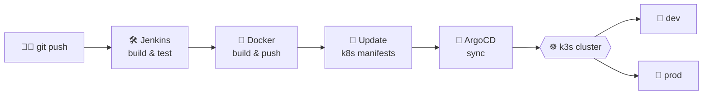

<!-- Header banner -->

  

<!-- Typing animation -->

  

  
  
  

---

## 👨‍💻 About me

- 💼 Currently working as a **Developer at LTM**
- 🎓 B.Tech in **Computer Science & Engineering**, based in **Nagpur, India**
- 🍊 Building **[Orangy](https://github.com/vedantkhursange/Orangy)**, a quick-commerce store live at **[orangeexpress.in](https://orangeexpress.in)**
- 📈 Built **[OrderUnlock](https://github.com/vedantkhursange/OrderUnlock)**, a free real-time NSE order block scanner with live futures OI
- ⚙️ I like the whole journey: UI, APIs, databases, containers and pipelines
- 🌱 Currently going deeper into **Kubernetes, GitOps and system design**
- 💬 Ask me about **Java, Spring Boot, React/Next.js, MERN, DevOps**
- 🎯 Goal: become a software developer who ships products people love

---

## 🛠️ Tech stack

<b>Languages</b>

  

<b>Frontend</b>

  

<b>Backend & data</b>

  

<b>DevOps & cloud</b>

  

<b>Tools & more</b>

  
   
  
  
  
  
  
  
  
  

---

## 🚀 Featured projects

<table>
  <tr>
    <td colspan="2" valign="top">
      <h3>📈 <a href="https://github.com/vedantkhursange/OrderUnlock">OrderUnlock</a></h3>
      
A free, real-time order block scanner for 141 NSE F&amp;O stocks, with every feature unlocked.

      

        
        
        
        
        
      

      
      Live prices every second over Server-Sent Events. It detects order blocks, break of structure, fair value gaps, VWAP and S/R levels, reads futures OI build-up from Upstox, and ranks a conviction score across a flow → contenders → top-setups pipeline with a hover spotlight. Zero dependencies, no build step.
    </td>
  </tr>
  <tr>
    <td width="50%" valign="top">
      <h3>🍊 <a href="https://github.com/vedantkhursange/Orangy">Orangy</a></h3>
      
A production quick-commerce platform, live at <a href="https://orangeexpress.in">orangeexpress.in</a>.

      

        
        
        
        
        
      

      JWT auth, Razorpay payments, OpenAPI docs, GSAP and Three.js UI. Shipped by Jenkins to k3s through ArgoCD, with separate dev and prod overlays.
    </td>
    <td width="50%" valign="top">
      <h3>☸️ <a href="https://github.com/vedantkhursange/orangy-k8s-manifests">orangy-k8s-manifests</a></h3>
      
The GitOps repo behind Orangy's deployments.

      

        
        
        
      

      Kustomize base plus dev and prod overlays for the frontend, backend, Postgres, MongoDB and Redis.
    </td>
  </tr>
  <tr>
    <td width="50%" valign="top">
      <h3>🚀 <a href="https://github.com/vedantkhursange/StartupNest">StartupNest</a></h3>
      
A startup incubation platform that connects entrepreneurs with mentors and funding.

      

        
        
        
        
      

      Idea submissions, mentor funding profiles, live status tracking and an AI chatbot. Deployed on Vercel.
    </td>
    <td width="50%" valign="top">
      <h3>✅ <a href="https://github.com/vedantkhursange/TaskWise">TaskWise</a></h3>
      
Dynamic task assignment for remote teams.

      

        
        
        
        
      

      MERN app with admin and member roles, task tracking, and dashboards built with Recharts.
    </td>
  </tr>
  <tr>
    <td width="50%" valign="top">
      <h3>🤖 <a href="https://github.com/vedantkhursange/MLT">MLT</a></h3>
      
Classic machine-learning algorithms implemented in Python.

      KNN, SVM, decision trees, naive Bayes, k-means, LDA, linear and polynomial regression, and a neural network.
    </td>
    <td width="50%" valign="top">
      <h3>🛒 <a href="https://github.com/vedantkhursange/amazon-clone">amazon-clone</a></h3>
      
An e-commerce storefront clone and an early step toward Orangy.

    </td>
  </tr>
</table>

---

## 🔁 How I ship

---

## 📊 GitHub stats

  
  

  

  

  

🔝 <b>Top contributed repos</b>

 

  

✍️ <b>Random dev quote</b>

 

  

---

## 🐍 Contribution snake

  <picture>
    <source media="(prefers-color-scheme: dark)" srcset="https://raw.githubusercontent.com/vedantkhursange/vedantkhursange/output/github-contribution-grid-snake-dark.svg" />
    
  </picture>

---

## 🌐 Connect with me

  
  
  

---

  <i>"First, solve the problem. Then, write the code."</i>

